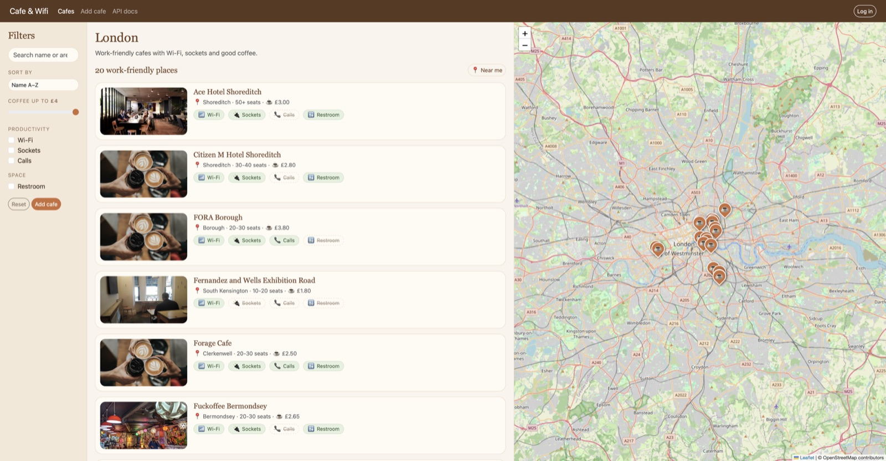

# Cafe & Wifi

An educational Python project: a REST API **and a website** for a database of London cafes with Wi-Fi and good coffee.

- **Website** (`/`): browse cafes on a list and a map, filter, sort, search, view a cafe's page, add new cafes, and (when logged in) edit or delete them.
- **REST API** (`/random`, `/all`, `/search`, ...): the original day 66 API, unchanged.



## Features

- Cafe list with a map showing a marker for every cafe. Hover a card or marker to highlight both; click to open the cafe's page.
- Filters: Wi-Fi, sockets, calls, restroom, coffee price (slider), text search by name or area.
- Sorting: name, cheapest or priciest coffee, most seats.
- "Near me": sorts cafes by distance from your browser's location.
- Single cafe page with photo, amenities, price, seats and a map.
- Add a cafe (photo by URL or upload). Coordinates are found automatically via OpenStreetMap.
- Edit and delete cafes, protected by a password login.
- Friendly placeholder photo when a cafe's image link is dead.

## Tech stack

- Python, Flask, Flask-SQLAlchemy, SQLite
- Flask-WTF (forms, CSRF protection), Bootstrap-Flask (Bootstrap 5)
- Leaflet + OpenStreetMap (maps), Nominatim (address lookup)
- python-dotenv (secrets), pytest (tests)
- Postman (API documentation)

## Running locally

```bash
python3 -m venv venv
source venv/bin/activate
pip install -r requirements.txt

cp .env.example .env      # then fill in SECRET_KEY and ADMIN_PASSWORD
python3 main.py
```

The site runs on `http://127.0.0.1:5001`.

`.env` values:

| Variable | Purpose |
|---|---|
| `SECRET_KEY` | Signs sessions and forms. Use a long random string, e.g. `python3 -c "import secrets; print(secrets.token_hex(32))"` |
| `ADMIN_PASSWORD` | Password for `/login`. Without it nobody can edit or delete cafes. |
| `DATABASE_URL` | Optional. Defaults to `sqlite:///cafes.db` (the file `instance/cafes.db`). |

### Database

Put the course's `cafes.db` into the `instance/` folder. The website also uses two extra columns for map markers; add them once to an existing database:

```bash
sqlite3 instance/cafes.db "ALTER TABLE cafe ADD COLUMN lat FLOAT; ALTER TABLE cafe ADD COLUMN lng FLOAT;"
```

Cafes without coordinates still appear in the list, just without a marker. Cafes added through the website get coordinates automatically.

## Website pages

| Route | Description |
|---|---|
| `/` | Cafe list, filters, sorting, search and map |
| `/cafe/<id>` | A single cafe |
| `/add-cafe` | Add a cafe |
| `/cafe/<id>/edit` | Edit a cafe (login required) |
| `/delete-cafe/<id>` | Delete a cafe, POST only (login required) |
| `/login`, `/logout` | Owner login |
| `/api-docs` | Link to the API documentation |

Filter parameters for `/`: `q`, `wifi=1`, `sockets=1`, `calls=1`, `toilet=1`, `max_price`, `sort` (`name`, `price_asc`, `price_desc`, `seats_desc`). Example: `/?wifi=1&sockets=1&sort=price_asc`.

## API routes

| Method | Route | Description |
|---|---|---|
| GET | `/random` | Get a random cafe |
| GET | `/all` | Get all cafes |
| GET | `/search?loc=<location>` | Search cafes by location |
| POST | `/add` | Add a new cafe |
| PATCH | `/update-price/<cafe_id>?new_price=<price>` | Update a cafe's coffee price |
| DELETE | `/report-closed/<cafe_id>?api-key=<key>` | Delete a cafe (requires api-key) |

Full documentation with example requests is published on Postman:
https://documenter.getpostman.com/view/42581230/2sBYAxQq5h

## Tests

```bash
pip install -r requirements-dev.txt
python3 -m pytest
```

The tests use a temporary database, so your real data is never touched.
